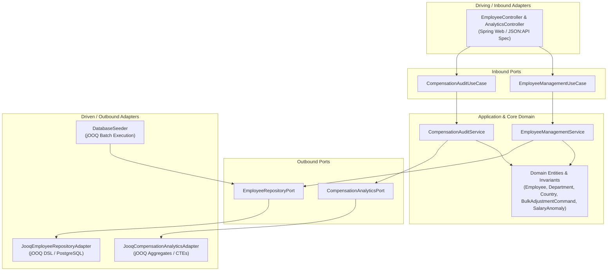

# GlobalPay HR: Enterprise Compensation Management System

[](https://spring.io/projects/spring-boot)
[](https://www.oracle.com/java/)
[](https://www.jooq.org/)
[](https://www.postgresql.org/)
[](https://jsonapi.org/)
[](https://reactjs.org/)
[](https://vitejs.dev/)
[](https://tailwindcss.com/)

---

## 1. Executive Summary & Architecture Overview

**GlobalPay HR** is a high-performance, enterprise-grade compensation management platform built to replace error-prone, fragmented spreadsheet workflows for ACME Corp's People Operations and HR Business Partners.

The system is engineered for sub-millisecond responsiveness across **10,000+ global employee records**, offering:
- **Server-Side Paginated Directory** with dynamic multi-attribute filtering adhering strictly to the **JSON:API specification**.
- **Real-Time Compensation Audit & Anomaly Detection** identifying unassigned salaries and extreme outliers (>3x department parity).
- **Targeted Bulk Salary Revision Engine** executing single-transaction updates across entire departments and countries.
- **Audited CSV Streaming Export** for seamless finance and payroll system integration.

---

## 2. Hexagonal Architecture (Ports & Adapters)

The backend strictly adheres to **Hexagonal Architecture** principles, guaranteeing that core business domains remain decoupled from external frameworks, database drivers, and delivery mechanisms.



### Layer Organization
- `domain/`: Pure Java domain models (`Employee`, `Department`, `Country`, `SalaryAnomaly`, `BulkAdjustmentCommand`, `PageResult`) and business invariants (e.g. non-negative salary validation, bounded raise percentages).
- `ports/inbound/`: Use-case interfaces (`EmployeeManagementUseCase`, `CompensationAuditUseCase`).
- `ports/outbound/`: Infrastructure contracts (`EmployeeRepositoryPort`, `CompensationAnalyticsPort`).
- `application/service/`: Transactional orchestrators implementing inbound ports and orchestrating outbound ports.
- `adapters/inbound/rest/`: Spring REST controllers producing and consuming payloads complying with the **JSON:API 1.1 Specification**.
- `adapters/outbound/persistence/`: High-performance persistence adapters powered by **jOOQ DSL**, executing type-safe SQL, dynamic query filters, multi-row batch inserts, and atomic bulk updates.

---

## 3. High-Performance jOOQ Seeding & Persistence

### 10,000 Record Batch Seeder
On application startup, `DatabaseSeeder` checks if the table is empty and uses jOOQ batch execution (`dsl.insertInto(EMPLOYEES)...values(...).execute()`) in chunks of 1,000 records.
- **Seeding Speed:** Seeds 10,000 realistic employees across 5 departments and 4 countries in **under 1.5 seconds**.
- **Distribution:**
  - **Departments:** `Engineering`, `Product`, `Sales`, `HR`, `Finance`
  - **Countries:** `United States (USD)`, `United Kingdom (GBP)`, `Germany (EUR)`, `India (INR)`
- **Controlled Audit Anomalies:**
  - 15 records with `$0.00` unassigned salary (onboarding audit flag).
  - 20 records with extreme outliers (`>3x` department average, e.g. `$650,000 - $1,100,000`).

---

## 4. REST API Documentation (JSON:API Specification)

All API responses follow the standard JSON:API specification (`{ data, meta, links, errors }`).

### 1. `GET /api/employees`
Paginated, searchable, and filterable employee directory.

**Query Parameters:**
- `page[number]` (or `page`): Current page (1-indexed, default: `1`)
- `page[size]` (or `size`): Records per page (default: `20`, max: `500`)
- `filter[search]` (or `q`): Substring search across first name, last name, email, and job title
- `filter[department]`: Filter by department (e.g., `Engineering`)
- `filter[country]`: Filter by country code (e.g., `India`, `US`)
- `filter[minSalary]`: Minimum annual salary
- `filter[maxSalary]`: Maximum annual salary
- `sort`: Field to sort (`id`, `salary`, `-salary`, `department`, `country`, `hire_date`)

**Example Response:**
```json
{
  "data": [
    {
      "type": "employees",
      "id": "1",
      "attributes": {
        "firstName": "Lukas",
        "lastName": "Wilson",
        "fullName": "Lukas Wilson",
        "email": "lukas.wilson1@acme.corp",
        "department": "HR",
        "country": "US",
        "countryDisplayName": "United States",
        "jobTitle": "People Operations Specialist",
        "salary": 95000.00,
        "currency": "USD",
        "currencySymbol": "$",
        "hireDate": "2025-02-24",
        "updatedAt": "2026-10-12T16:24:39+05:30"
      },
      "links": {
        "self": "/api/employees/1"
      }
    }
  ],
  "meta": {
    "totalRecords": 10000,
    "totalPages": 500,
    "currentPage": 1,
    "pageSize": 20
  },
  "links": {
    "self": "/api/employees?page[size]=20&page[number]=1",
    "first": "/api/employees?page[size]=20&page[number]=1",
    "prev": null,
    "next": "/api/employees?page[size]=20&page[number]=2",
    "last": "/api/employees?page[size]=20&page[number]=500"
  }
}
```

### 2. `PUT /api/employees/{id}`
Updates individual compensation.

**Request Payload:**
```json
{
  "data": {
    "type": "employees",
    "id": "1",
    "attributes": {
      "salary": 105000.00
    }
  }
}
```
*(Also accepts flat `{ "salary": 105000.00 }`)*

### 3. `POST /api/employees/bulk-adjust`
Executes an atomic SQL update across all matching records in a single database round-trip.

**Request Body:**
```json
{
  "department": "Engineering",
  "country": "India",
  "percentage": 10.0
}
```

**Response:**
```json
{
  "data": {
    "type": "bulk-adjustments",
    "id": "latest",
    "attributes": {
      "affectedEmployees": 460,
      "department": "Engineering",
      "country": "India",
      "percentage": 10.0,
      "executedAt": "2026-10-12T16:24:54+05:30"
    }
  }
}
```

### 4. `GET /api/analytics/summary`
Returns aggregated corporate metrics, department breakdown, regional distribution, and the list of flagged audit anomalies.

### 5. `GET /api/employees/export-csv`
Streams an immediate CSV download of the currently active filtered view with appropriate `Content-Disposition: attachment; filename="globalpay-employees-export.csv"`.

---

## 5. Quickstart Guide

### Prerequisites
- **Java 21 LTS**
- **Maven 3.9+**
- **Node.js 20+**
- **Docker** (Optional, for running native PostgreSQL)

---

### Step 1: Start PostgreSQL (Optional)
You can launch PostgreSQL 16 using Docker Compose:
```bash
docker compose up -d
```
*Note: If Docker is not running, GlobalPay HR automatically starts with an embedded PostgreSQL-compatible engine with zero configuration required!*

---

### Step 2: Launch the Backend
```bash
cd backend
mvn spring-boot:run
```
To run against the local Docker PostgreSQL container:
```bash
mvn spring-boot:run -Dspring-boot.run.profiles=postgres
```
The backend starts at `http://localhost:8080` and immediately seeds 10,000 employee records via jOOQ.

---

### Step 3: Launch the Frontend
```bash
cd frontend
npm install
npm run dev
```
Open your browser at `http://localhost:5173`.

---

## 6. Running Tests
Run the test suite verifying domain validation rules, compensation boundaries, and use-case services:
```bash
cd backend
mvn test
```
All tests execute in milliseconds using Mockito and JUnit 5.
